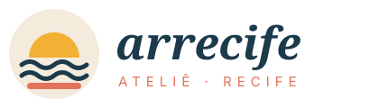

# Identidade visual — Arrecife Ateliê

> Versão navegável deste manual: abra `marca.html` no site.

## 1. A marca

| | |
|---|---|
| **Nome** | Arrecife Ateliê |
| **Slogan** | *Moda leve, feita no Recife, com a calma da maré.* |
| **Segmento** | Moda autoral feminina e unissex, tecidos naturais, produção local em pequena escala |
| **Público** | Pessoas de 22 a 45 anos que valorizam conforto para o calor, produção local e estilo próprio |
| **Loja física** | Rua da Moeda, 140 — Bairro do Recife (Recife Antigo), Recife/PE, CEP 50030-040 *(endereço fictício)* |
| **Contato** | (81) 3000-0000 · ola@arrecife.com.br · @arrecife.atelie *(fictícios)* |

### Por que “Arrecife”?
*Arrecife* é a forma antiga de “recife”. A cidade ganhou o nome por causa da barreira de pedras que protege o porto e transforma o mar agitado em água calma. A marca usa a mesma ideia: **roupas que acolhem e deixam a gente leve**.

### Localização: por que o Recife Antigo?
O Bairro do Recife é o marco zero da cidade, com casarões coloridos, a Rua do Bom Jesus, o Paço do Frevo e o movimento do *Recife Antigo de Boa* aos domingos. É turístico e local ao mesmo tempo — ideal para uma loja que também é ateliê.

### Coleções
- **Capibaribe** — tons de rio e fim de tarde; linho e viscose.
- **Frevo** — amarelos, corais, listras; alegria de carnaval.
- **Mangue** — verdes e terrosos; homenagem ao Manguebeat.

## 2. Logo

- **Símbolo** (`assets/simbolo.svg`): sol amarelo nascendo sobre duas ondas azuis e a linha coral do arrecife — a vista do Marco Zero ao amanhecer.
- **Logotipo**: “arrecife” em *Fraunces itálico* minúsculo (próximo, artesanal) + “ATELIÊ · RECIFE” em *Inter* espaçado.
- **Respiro**: deixe ao redor um espaço livre igual à altura da letra “a”.
- **Tamanho mínimo**: 120 px de largura (logo completo) / 24 px (símbolo).
- **Não**: distorcer, girar, trocar as cores do símbolo ou aplicar sobre fotos poluídas.

## 3. Cores

| Nome | HEX | Uso |
|---|---|---|
| 🟦 Azul Maré | `#1B3A4B` | Cor principal: botões, títulos, rodapé |
| 🟥 Coral Recife | `#E2725B` | Destaques, promoções, chamadas para ação |
| 🟨 Sol do Frevo | `#F2B134` | Detalhes, ícones, cupons |
| 🟩 Verde Mangue | `#4F6F52` | Apoio, sustentabilidade, status “concluído” |
| ⬜ Areia | `#F4EBDD` | Fundos de seção e cards |
| ⬛ Tinta | `#1E1E1E` | Texto corrido |

**Proporção sugerida:** 60% Areia/Branco · 25% Azul Maré · 10% Coral · 5% Sol e Mangue.

No código, as cores são variáveis CSS no topo de `css/estilos.css` (`--azul-mare`, `--coral`…).

## 4. Tipografia

| Fonte | Uso | Onde baixar |
|---|---|---|
| **Fraunces** (serifada) | Títulos, logotipo, citações | Google Fonts (gratuita) |
| **Inter** (sem serifa) | Textos, botões, preços, menus | Google Fonts (gratuita) |

## 5. Tom de voz

- **Próximo e caloroso** — “Vem ver a nova coleção!”
- **Orgulhosamente recifense** — citar bairros, ruas, frevo e mangue, sem caricatura.
- **Leve** — promoção é convite, não pressão. Nada de “ÚLTIMAS HORAS!!!”.
- **Inclusivo** — preferir termos neutros (“quem veste”, “nossa clientela”).

## 6. Elementos gráficos

- **Ondas** como divisória (fim do destaque da página inicial).
- **Arcos de sol** no topo de cards de destaque.
- Cantos arredondados (**14 px**) e botões em formato de pílula.
- Ícones de traço fino (1,8 px), na cor Azul Maré.
- Ilustrações chapadas das peças, com estampas simples (liso, listras, poás).
